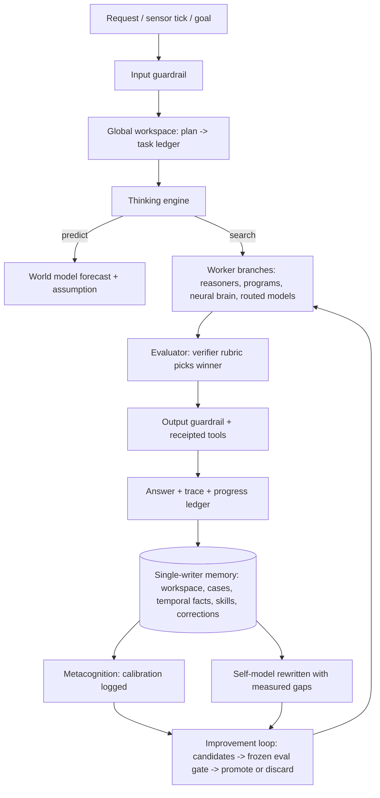

# 🧠 Janus — A Self-Improving, Ground-Connected General Agent

A self-improving, ground-connected general agent. It reasons through a global
workspace, learns from its own experience behind an evidence gate, roams the
web in a real browser, lives on live sensor data, and owns its brain — 1.83M
parameters trained from scratch on this machine.

> **Honest identity:** a corrigible agentic system, not a claimed AGI. Every
> score it reports is measured on frozen evals it cannot edit. Breadth is
> earned per-eval, never asserted.

## The pipeline



The loop's single rule: **no capability ships without beating the frozen eval
with zero regression** — else it is discarded and the live system is untouched.
That is what makes self-improvement measurement, not theater.

## Capabilities

| Layer | Implementation |
|---|---|
| Thinking | Predict-first + verifier-guided search (`thinking.py`); multi-step programmatic reasoners |
| Own brain | Transformer from scratch (`neural.py`, 1.83M params, INT8 1.8MB) — gate status: benched at 1.7% held-out, retraining |
| Memory | Single writer: working / episodic / temporal facts / success-rated skills / verbatim corrections (`memory.py`) |
| Learning | Self-curriculum with ground truth, self-distillation, gated evolution (`curriculum.py`, `loop.py`) |
| Web | Keyless crawlers (trafilatura/bs4 tiers, DDG search, RSS), real Chromium browser (`crawlers.py`, `browser.py`) |
| Tools | Receipted registry + approval rings; MCP client for 120k+ servers (`tools.py`, `mcp_client.py`) |
| Sensors | Weather, air quality, earthquakes, ISS, news — all live, zero keys (`sensors.py`) |
| Social | Keyless reading (HN live); posting draft-first behind credentials + per-action approval (`social.py`), world ring |
| Perception | Text affect sensor; V1 dissonance engine folded in (`perception.py`, `perception_audio.py`) — sensor, never lie detector |
| Safety | Input/output guardrails, quality quarantine, diff-logged revertible memory edits |

## Scores (frozen evals, first-attempt)

| Axis | Cases | SCORE |
|---|---|---|
| Finance (frozen) | 20 | 1.0000 |
| Growth | 10 | 1.0000 |
| General | 24 | 1.0000 |
| Transfer (unseen types) | 8 | 1.0000 |
| Multi-step thinking | 8 | 1.0000 |

Run them: `python -m janus_v2.eval --eval-file janus_v2/eval_general.jsonl`
(and the other three files).

## Run it

```bash
git clone https://github.com/DevodG/Janus.git && cd Janus

# API (port 7860)
python3 -m janus_v2.api

# Console (Next.js, /v2 page)
cd frontend && npm install && npm run dev   # open http://localhost:3000/v2

# Tests
python3 -m pytest janus_v2/tests -q

# Improvement loop (one cycle)
python3 -m janus_v2.loop --rounds 12

# Self-curriculum (Janus practices, finds its gaps, rewrites its self-model)
python3 -m janus_v2.curriculum --n 40

# Train Janus's own brain from scratch (local MPS/CPU)
python3 -m janus_v2.neural --steps 1200
python3 -m janus_v2.quantize   # INT8 + held-out audit
```

Offline-first: with no keys set, Janus reasons with its own registry and
crawlers. Opt-in models: `JANUS_LLM_BASE_URL=http://localhost:11434/v1`
(Ollama) or `ANTHROPIC_API_KEY`, selected by `JANUS_PROVIDER_ORDER`.

## Layout

```
janus_v2/              # the system (primary)
  agent.py             # kernel: workspace + plan/act/verify/synthesize
  reasoners.py         # pluggable worker registry (math/finance/program/language/knowledge)
  thinking.py          # predict + verifier-guided search
  neural.py quantize.py# own brain + INT8 with held-out audit
  memory.py            # single-writer memory + quality quarantine
  curriculum.py loop.py# self-learning + gated evolution
  crawlers.py browser.py sensors.py social.py  # feet, eyes, nervous system
  mcp_client.py        # MCP ecosystem plug-in
  api.py               # service: /run /run/stream /live /eval /loop/status /model
  eval*.jsonl          # frozen + growth + general + transfer + think evals
archive_v1/            # V1 mutators and duplicate stores (relocated, not deleted)
backend/ frontend/     # legacy V1 reference + console (V2 page at /v2)
```

*Janus Adapts. Janus Dreams. Janus Protects. Every change on evidence.*
